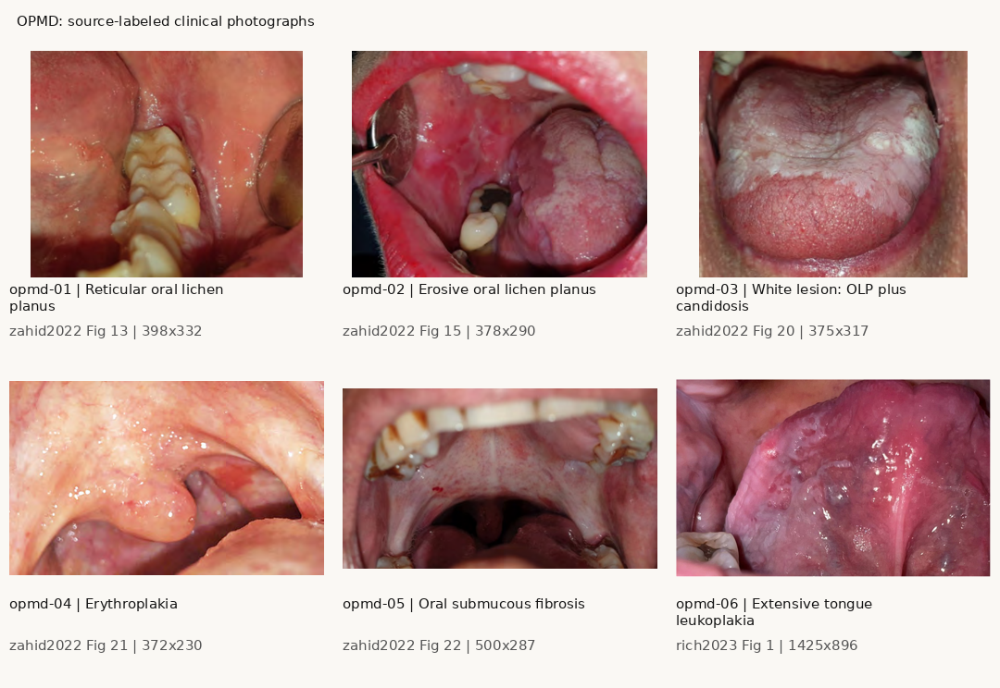
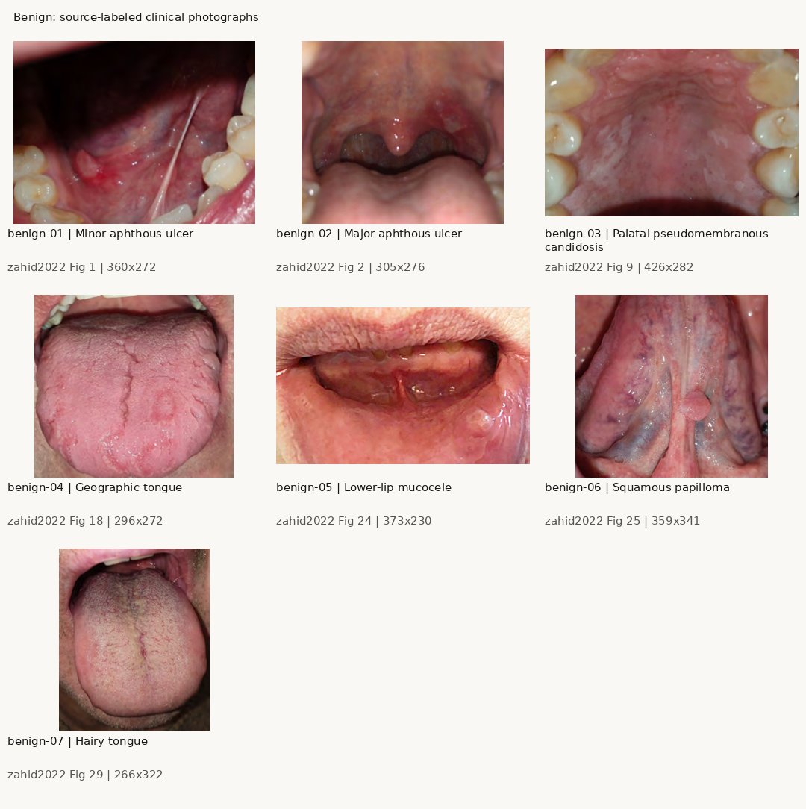

# OncoEdge evaluation: 17 published clinical photographs

This is the retained baseline at commit `1f195a099c4bdde1341375fc1368ace8f9408e9c`, before the local code fixes. See [FIXES.md](FIXES.md) for the fixed pipeline's replay; the original numeric results below are preserved.

**The baseline pipeline returned no detections and LOW risk for all 17 photographs, including all four source-labeled cancers. A controlled color-input experiment confirmed an RGB/BGR integration bug. Correcting that input alone returned boxes in 11 photographs, but classification and risk errors remained.**

This is an exploratory technical evaluation completed on 5 October 2026. It establishes specific failure cases and integration defects. It does not estimate clinical sensitivity, specificity, or diagnostic accuracy.

## Photos and visual review

The set contains four oral squamous cell carcinoma photographs, six potentially malignant disorder photographs, and seven benign-condition photographs from three publications. Every input was visually inspected. All are single clinical photographs; there are no histology slides, radiographs, collages, diagnostic text labels, or screenshots in the model inputs. Labels come from the publications, not from the assistant diagnosing the photographs by sight.

The potentially malignant set covers leukoplakia, oral lichen planus, erythroplakia, and submucous fibrosis. The benign set covers aphthous ulcers, pseudomembranous candidosis, geographic tongue, mucocele, papilloma, and hairy tongue. The mixed OLP/candidosis case is mapped to OPMD because of its source-described OLP; that broad mapping should be reviewed by a clinician before using this set as ground truth.

Fourteen photos are from [Zahid et al., 2022](https://pmc.ncbi.nlm.nih.gov/articles/PMC9809440/), two from [Markopoulos, 2012](https://www.opendentistryjournal.com/VOLUME/6/PAGE/126/FULLTEXT/), and one from [Rich et al., 2023](https://www.frontiersin.org/journals/oral-health/articles/10.3389/froh.2023.1122497/full). Full attribution and licenses are in [ATTRIBUTION.md](ATTRIBUTION.md); per-photo provenance, dimensions, hashes, figure numbers and visual observations are in [manifest.json](manifest.json).

Most publisher-PDF photos are compressed, approximately 266–500 pixels wide. The Frontiers photograph is 1425 × 896. Teeth, retractors, saliva glare and soft focus were retained. Embedded photographs were extracted at their original PDF resolution; separate vector arrows/captions on the PDF pages are absent from the extracted inputs. No enhancement, lesion crop, color adjustment, or model-driven case selection was applied before testing.

The cancer contact sheet is retained locally; two photographs have a
noncommercial license and are not redistributed in this repository.





## Baseline: actual project behavior

The baseline calls `OncoEdgePipeline.process_image` unchanged, with the project's trained `best.pt`, CPU/PyTorch backend, YOLO confidence threshold 0.25 and inference size 640. Every photograph uses the same **synthetic** metadata: age 45, tobacco use 0 years, lesion duration under 2 weeks. These values are controls, not the subjects' medical histories.

| Published category | Photos | Photos with a baseline detection | Baseline LOW results |
| --- | ---: | ---: | ---: |
| OCA / oral cancer | 4 | 0 | 4 |
| OPMD | 6 | 0 | 6 |
| Benign | 7 | 0 | 7 |
| **Total** | **17** | **0** | **17** |

All baseline risk scores were **1.50** and the recommendation was “No lesions detected. Routine monitoring recommended”. The classifier was skipped on every baseline case because there were no YOLO boxes. A LOW result here therefore does not represent a benign or normal image classification.

The hosted application was also checked through its actual upload interface with `oca-04.png`. It displayed zero lesions and LOW 1.5/10 with the same controlled metadata, agreeing with the local baseline. [Saved browser evidence](hosted-baseline-dom.txt) records that result. The screenshot is retained locally under the photograph's noncommercial license.

Re-evaluating the same zero vision scores with synthetic age 65, tobacco use 20 years and duration over 6 weeks still yields **LOW, score 5.00**, for every case. The implementation adds at most 5.0 from those factors and requires a score strictly greater than 5.0 for MEDIUM.

The same all-factors scenario was confirmed on the actual hosted upload interface for `oca-04.png`: zero lesions and LOW 5.0/10. [Saved browser evidence](hosted-high-factors-dom.txt) records the synthetic inputs and result. The screenshot is retained locally under the photograph's noncommercial license.

## Controlled diagnostic experiments

These experiments were performed locally and **have not changed the deployed application**. All input photos, checkpoint weights and classifier prompts remain fixed.

### 1. Correct YOLO's NumPy color input

The interface produces RGB arrays. The detector passes those arrays directly into Ultralytics, whose NumPy contract is BGR; its installed preprocessing reverses the final channel axis before inference. Consequently, the current pipeline swaps red and blue at the model input. [Ultralytics' prediction documentation](https://docs.ultralytics.com/modes/predict/) confirms that NumPy input uses BGR while PIL input uses RGB.

In the diagnostic experiment, only the array supplied to YOLO was converted from RGB to BGR. BioMedCLIP crops and visualization continued to use the original RGB photograph.

| Category | Photos | BGR experiment: photos with boxes | Photos containing any crop whose class matches the reference |
| --- | ---: | ---: | ---: |
| OCA | 4 | 2 | 1 |
| OPMD | 6 | 5 | 3 |
| Benign | 7 | 4 | 2 |
| **Total** | **17** | **11** | **6** |

The 11/17 count measures the presence of boxes, **not correct lesion localization**. Visual review of the diagnostic overlays found broad, overlapping boxes in several cases. There are no reference boxes or masks, so mAP, segmentation quality and localization accuracy cannot be computed from this set. No detected box on a source-labeled cancer carried YOLO's own OCA label; one of those cases subsequently received OCA from BioMedCLIP on a crop.

The rendered color-input comparison is retained locally because it includes a
photograph with a noncommercial license. Per-case outputs are in `results.json`.

On the right-hand overlays, class names are the BioMedCLIP crop outputs; numeric box labels are YOLO detection confidence, not disease probabilities. These are diagnostic outputs, not a deployed fix.

### 2. Run BioMedCLIP on the whole photograph

This isolates the classifier when detection fails; **the production pipeline has no whole-image fallback**. Whole-photo preprocessing also differs from classification on a detected lesion crop, so these results cannot substitute for end-to-end performance.

| Category | Whole-image top class matching reference |
| --- | ---: |
| OCA | 1 / 4 |
| OPMD | 3 / 6 |
| Benign | 3 / 7 |
| **Total** | **7 / 17** |

Examples of high-scoring disagreements: `oca-01` was classified Benign with a relative score of 0.996; `oca-02` was classified OPMD at 0.996; `opmd-05` was classified Normal at 0.999. The four-prompt softmax values are relative similarities, not calibrated diagnostic probabilities. The OPMD prompt describes leukoplakia and the Benign prompt describes aphthous ulcers, while the project's categories cover a wider range of conditions.

### 3. Lower confidence threshold without correcting colors

Using confidence 0.10 with the original RGB-array behavior still produced **0/17 photographs with boxes**. Lowering this threshold did not resolve the observed integration failure.

## Risk logic failures demonstrated

1. **A detector miss becomes LOW risk.** In the baseline all four published cancers receive LOW because classification is skipped and only patient factors remain.
2. **The formula ignores the predicted class.** It multiplies YOLO confidence by the maximum BioMedCLIP score, then adds patient factors. A confident Normal or Benign classification can therefore increase risk exactly like an OCA classification.
3. **A concrete Normal-driven result:** in the BGR experiment on `benign-06`, the strongest fused crop is classified Normal, with YOLO confidence 0.516 and classifier score 0.889. Their product is 0.459; the formula returns MEDIUM, score 6.09. Other crops in that image were classified OPMD, but none exceeded the Normal crop's fused score.
4. **Color correction is insufficient:** `oca-01` remains LOW after the BGR experiment; `oca-02` and `oca-03` still have no boxes; the extensive leukoplakia case `opmd-06` produces a Benign crop and LOW risk.

## Every case

Baseline is **zero boxes, LOW 1.50** for every row. The whole-image and BGR columns below are separate experiments.

| Case | Published reference | Whole-image classifier | BGR boxes | BGR crop classes | BGR risk |
| --- | --- | --- | ---: | --- | --- |
| oca-01 | OCA | Benign | 1 | Benign | LOW 4.16 |
| oca-02 | OCA | OPMD | 0 | — | LOW 1.50 |
| oca-03 | OCA | OCA | 0 | — | LOW 1.50 |
| oca-04 | OCA | Benign | 2 | OCA, Benign | MEDIUM 7.00 |
| opmd-01 | OPMD | OPMD | 1 | OPMD | LOW 2.83 |
| opmd-02 | OPMD | OPMD | 1 | OPMD | LOW 4.19 |
| opmd-03 | OPMD | OPMD | 0 | — | LOW 1.50 |
| opmd-04 | OPMD | Benign | 2 | Benign, OCA | MEDIUM 7.06 |
| opmd-05 | OPMD | Normal | 2 | OPMD, Normal | MEDIUM 5.13 |
| opmd-06 | OPMD | OCA | 1 | Benign | LOW 3.24 |
| benign-01 | Benign | Benign | 3 | Benign, Benign, Benign | LOW 4.84 |
| benign-02 | Benign | Benign | 1 | Benign | LOW 3.08 |
| benign-03 | Benign | Normal | 1 | Normal | LOW 4.72 |
| benign-04 | Benign | OPMD | 0 | — | LOW 1.50 |
| benign-05 | Benign | Benign | 0 | — | LOW 1.50 |
| benign-06 | Benign | Normal | 4 | Normal, Normal, OPMD, OPMD | MEDIUM 6.09 |
| benign-07 | Benign | Normal | 0 | — | LOW 1.50 |

Per-crop boxes, YOLO classes, all classifier scores, risk outputs and timing are saved in [results.json](results.json). [results.csv](results.csv) provides a spreadsheet-friendly case summary. CC BY 4.0 input photos are in [images/](images/); baseline and BGR overlays are stored separately. The two CC BY-NC inputs and their derivatives stay local; their provenance and hashes remain in the manifest. Obtain those inputs under their source license before replaying all 17 cases.

## Limits and interpretation

This is a convenience sample from published teaching/review papers. The cases were selected before running inference, but the class mix is deliberately chosen and does not reflect prevalence. There are no healthy controls, no blinded clinician annotation, no confirmed independent patient grouping, and no verified bounding boxes or segmentation masks. Source labels are not necessarily biopsy-confirmed in every figure. The OLP/candidosis example has a mixed diagnosis.

The full YOLO training images are unavailable locally; published-image overlap cannot be ruled out from metadata alone. BioMedCLIP was pretrained on biomedical figure-caption pairs from PubMed Central, so pretraining overlap is also possible. [Microsoft's model card](https://huggingface.co/microsoft/BiomedCLIP-PubMedBERT_256-vit_base_patch16_224) documents its PMC-15M training corpus and research scope. These photos therefore must not be presented as an independent clinical validation benchmark.

The outcome supports a concrete engineering conclusion: the project demonstrates an edge-computing architecture and a runnable web deployment, but the present outputs are not a dependable medical screening result. The channel-order bug and no-detection risk behavior should be addressed before presenting the demo as evidence of screening performance.

## Recommended next changes

1. Fix the detector's RGB/BGR boundary while keeping BioMedCLIP and displayed images RGB; verify the fix on these saved cases.
2. Display an inconclusive/not-assessed state when detection fails, instead of implying reassuring LOW risk. Adding a whole-photo fallback alone is inadequate given the disagreements above.
3. Redesign risk assessment to consider malignant/potentially malignant class evidence and uncertainty rather than maximum confidence of any class. Validate thresholds with expert-labeled data.
4. Evaluate detection, segmentation, classification and final decision separately on a held-out, patient-level split with healthy controls. Report clinical metrics only after that evaluation.

No production code, model weights, classifier prompts, thresholds or hosted sample picker were changed during this evaluation.

## Reproduce

From the repository root, using the existing uv-created virtual environment and cached models:

```bash
HF_HUB_OFFLINE=1 TRANSFORMERS_OFFLINE=1 OMP_NUM_THREADS=2 \
MKL_NUM_THREADS=2 OPENBLAS_NUM_THREADS=2 \
.venv/bin/python evaluation/evaluate_cases.py evaluation/2026-10-05/manifest.json
```

The script checks every image hash and visual-review status, observes the unchanged pipeline, and writes baseline results plus explicitly separate diagnostic experiments. Git revision and checkpoint/package hashes/versions are in `results.json`. Local CPU initialization took 5.29 seconds; median baseline inference was 0.085 seconds because the classifier was skipped. These timings are not AWS or Jetson benchmarks.
